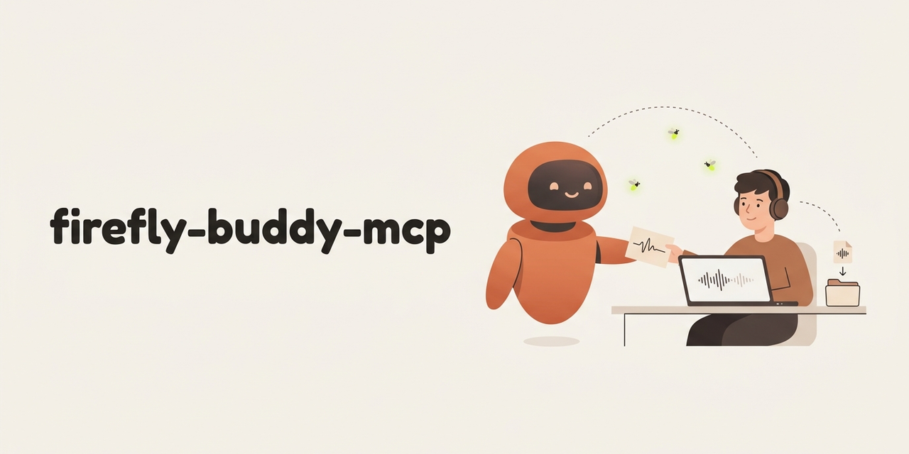

# firefly-buddy-mcp



<sub>この絵は [gemini-buddy-mcp](https://github.com/holmesfems/gemini-buddy-mcp) の `gemini_generate_image`（`backend="agy"`）で作りました。</sub>

Claude が「この効果音を Adobe Firefly で作ってきて」と人間に頼むための MCP サーバー。
Firefly（Web）の生成クレジットを使って効果音を作り、ダウンロードしたファイルを Claude が指定したフォルダへ自動で届ける。

## なぜ人間に頼むのか

- Firefly の Web アプリのクレジットを使える API は無い（Firefly Services API は企業向けの別契約で、効果音の API も見当たらない）。
- Adobe の生成 AI 利用ガイドラインは、許可のない自動化・スクリプトでの操作を禁じている。ブラウザを自動で操作しない。
- 効果音は当たり外れが大きいので、Firefly が出す 4 案から人間が耳で選ぶ工程は、むしろあったほうがいい。

## 流れ

```
Claude ── firefly_request_sfx（英語のプロンプトをまとめて）──▶ デスクトップに窓が出る
人間   ── 「コピーして受け取り開始」→ Firefly に貼って生成 → 気に入った案をダウンロード
窓     ── ダウンロードフォルダに届いたファイルを拾い、16bit PCM・48kHz の wav にして dest_dir へ
Claude ── firefly_status で受け取りを確かめる
```

- 窓は、項目のボタンを押した後に届いた `.wav` だけを拾う（Firefly の効果音は `.wav` で落ちてくる）。それ以外のダウンロードには触らない。
- 同じ中身のファイルは、同じ依頼の中で二度受け取らない（同じ案を二度落とした、受け取ったファイルを手で選び直した、など）。
- 拾ったファイルの元（Firefly から落としたまま）は `~/.firefly-buddy-mcp/originals/<batch_id>/` に移す。
- 拾い漏れたら、窓の「ファイルを選ぶ…」か、Claude の `firefly_attach` で渡せる。

## ツール

| ツール | 内容 |
|---|---|
| `firefly_request_sfx` | 効果音をまとめて頼む（1 回 12 件まで）。すぐ `batch_id` を返し、窓を開く |
| `firefly_status` | 受け取りの状況。`wait_seconds`（110 秒まで）で、変化があるまで待てる。`reopen_popup` で窓を開き直す |
| `firefly_attach` | ファイルを手で渡す（コピーして変換する） |
| `firefly_cancel` | 待っている項目を取り消す |

項目（`items` の 1 つ）:

| キー | 内容 |
|---|---|
| `name` | できたファイルの名前（拡張子なし）。2 つ目からは `_2`・`_3` が付く |
| `prompt` | Firefly に貼るプロンプト。**英語だけ**（Firefly の効果音は英語しか受け付けない）、750 字まで |
| `note` | 人間向けの日本語のメモ（何に使うか・どんな音なら当たりか） |
| `duration` | 長さ（秒）。窓に「Duration を ◯ 秒に」と出る。Firefly の Duration は既定が 8 秒で、一発の音もそのままだと 8 秒の地鳴りになるので必ず付ける |
| `dest_dir` | 入れる先（絶対パス）。省略すると `~/.firefly-buddy-mcp/outbox/<batch_id>/` |
| `want` | 4 案のうち何案まで残すか（1〜4） |
| `convert` | `pcm16`（16bit PCM・48kHz の wav。既定）か `none`（Firefly のファイルのまま） |
| `trim_silence` | 頭の無音を切る（既定 true） |

## AK Studio の効果音で使う

`dest_dir` を `<回のフォルダ>/fx/se/<種類>`（`chapter`・`slam`・`wipe`・`blip` など）にすると、
AK Studio の「効果音の設定」の候補に自動で並ぶ（AK Studio は 16bit PCM の wav だけ読む）。
どれを鳴らすかは、ユーザーが聞き比べて決める。

## 入れ方

```powershell
git clone https://github.com/holmesfems/firefly-buddy-mcp
cd firefly-buddy-mcp
python -m venv .venv
.venv\Scripts\python -m pip install -e .
```

venv 内の実行ファイルを指定して登録します（パスは clone した場所に合わせてください）。`--scope user` を付けると、どのプロジェクトからも使えます。

```powershell
claude mcp add firefly-buddy --scope user -- "C:\path\to\firefly-buddy-mcp\.venv\Scripts\firefly-buddy-mcp.exe"
```

窓は tkinter（Python に同梱）で出します。今のところ Windows で動作を確かめています。

ffmpeg は PATH にあればそれを、無ければ `imageio-ffmpeg` の同梱版を使う。

環境変数（任意）:

| 変数 | 内容 |
|---|---|
| `FIREFLY_BUDDY_HOME` | 依頼・結果を置く場所（既定 `~/.firefly-buddy-mcp`） |
| `FIREFLY_BUDDY_DOWNLOADS` | 見張るフォルダ（既定は Windows の「ダウンロード」） |
| `FIREFLY_BUDDY_WATCH_EXT` | 見張る拡張子（既定 `.wav`。例 `.wav,.zip`。音声・動画・zip 以外は無視） |
| `FIREFLY_BUDDY_FFMPEG` | ffmpeg の場所 |

## テスト

```powershell
.venv\Scripts\python -m unittest discover -s tests
```

窓（tkinter）と Firefly そのものは、テストでは動かさない。
